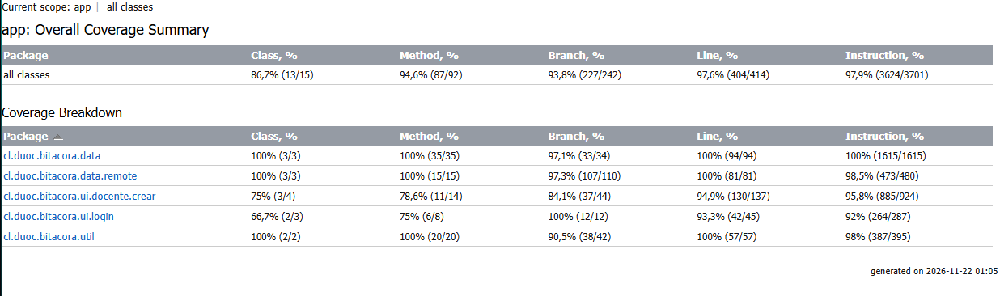

# Mi Bitácora (Bitácora Escolar)

Aplicación móvil Android (Kotlin + Jetpack Compose) para administrar **bitácoras mensuales de aprendizaje**
por curso y asignatura en un establecimiento educacional público (5.º a 8.º básico).

Proyecto de la **Evaluación Parcial 4** de *DSY1105 – Desarrollo de Aplicaciones Móviles* (Duoc UC).
Continúa la app de la Evaluación Parcial 2: ahora los datos viven en **microservicios propios en Spring Boot**
y la app se conecta a ellos con **Retrofit**.

> Todo el contenido (usuarios, cursos, bitácoras y registros) es **ficticio**. No se usan datos reales de estudiantes.

## Integrantes

- Natalia Millaray Leiva Millaqueo
- Juan Pablo Marambio Zagal

## Repositorios

| Parte | Repositorio |
|---|---|
| App móvil (este repositorio) | [natyleiv/proyectoColegio](https://github.com/natyleiv/proyectoColegio) |
| Microservicios (backend) | [natyleiv/backendBitacora](https://github.com/natyleiv/backendBitacora) |

## Problema que resuelve

Los estudiantes registran lo aprendido en cuadernos, guías y fotos sueltas, y el docente no tiene un lugar
único para ver los aportes, dar retroalimentación e identificar quién no ha participado.
La app centraliza la **bitácora mensual** y mantiene cada registro privado entre el estudiante y su docente.

## Arquitectura

```
                         Retrofit (http://10.0.2.2)
App Android  ──────────────────────────────────────►  ms-usuarios   :8081  →  MySQL colegio_usuarios
(Compose + MVVM)                                      login, cursos, asignaturas, usuarios, asignaciones
      │
      │      ─────────────────────────────────────►  ms-bitacoras  :8082  →  MySQL colegio_bitacoras
      │                                               bitácoras, preguntas, registros, retroalimentación
      ▼
   Room (copia local de lo que responde el backend)
```

Dentro de la app cada pantalla sigue **MVVM**: `Screen` → `ViewModel` → `UiState` → `Repository` → (`Api` de Retrofit + `Dao` de Room).

Cómo viajan los datos:

- **Al escribir** (crear, editar, publicar, enviar, comentar, eliminar): el Repository llama **primero al microservicio**.
  Solo si responde bien se guarda en Room, con el **id que asignó el servidor**. Si el backend rechaza la operación
  (por ejemplo, *"Ya existe una bitácora de este mes…"*), la app muestra **ese mismo mensaje** y no guarda nada.
- **Al leer**: al iniciar sesión se descargan los datos base (cursos, asignaturas, usuarios y asignaciones) y al entrar
  a cada pantalla se sincronizan las bitácoras, registros y comentarios. Las pantallas observan Room con `Flow`,
  así que se actualizan solas.
- **Persistencia local**: Room se mantiene (como en la EP2) como copia local; las pantallas arman los nombres de
  cursos, asignaturas y estudiantes con consultas `JOIN` sobre esa copia.

## Funcionalidades implementadas

**Docente**
- Inicio de sesión validado por `ms-usuarios` y consulta de sus cursos y asignaturas asignados.
- Crear bitácora mensual (curso, asignatura, mes y año elegidos en un **calendario**, título, propósito, instrucciones y preguntas orientadoras). Queda en **borrador** en el servidor.
- **Editar** y **eliminar** una bitácora mientras está en borrador (con confirmación antes de eliminar).
- Publicar y cerrar una bitácora (la fecha de publicación y de cierre la pone el backend).
- Ver los aportes enviados, con filtros por estado (todos, pendientes, revisados), búsqueda por nombre del estudiante y filtro por fecha de clase.
- Ver indicadores de participación (participaron / total, sin participación, aportes revisados y pendientes).
- Revisar un aporte (texto, foto y enlace) y escribir o actualizar la retroalimentación.

**Estudiante**
- Inicio de sesión validado por `ms-usuarios` y consulta de las bitácoras publicadas de su curso.
- Crear un registro de clase (fecha elegida en un **calendario** —sin días futuros y dentro del mes de la bitácora—, contenido, actividad, aprendizaje, dudas y enlace).
- Guardar como **borrador**, seguir editándolo, **eliminarlo** (con confirmación) o **enviarlo** al docente.
- Adjuntar una foto desde la **galería** (Photo Picker) o con la **cámara**.
- Consultar su historial, el estado de cada aporte (borrador / enviado / pendiente / revisado) y la retroalimentación.

**Estados visuales y mensajes**
- Estado de **carga**: el botón de ingreso se desactiva y muestra *"Ingresando…"* mientras responde el servidor.
- Estado de **error**: si un microservicio está apagado aparece *"No se pudo conectar con el servidor…"*; si el backend
  rechaza una operación se muestra su mensaje (por ejemplo, bitácora duplicada o fecha fuera del mes).
- Cada operación muestra un Snackbar **verde** (éxito), **ámbar** (advertencia) o **rojo** (error). Colores centralizados en `ui/theme/Color.kt`.
- Notificaciones del sistema al publicar una bitácora y al enviar un registro.

**Seguridad (control de acceso)**
- Cada pantalla valida el perfil (docente / estudiante) antes de mostrarse.
- La app revisa antes de llamar al backend que la bitácora o el registro pertenezcan al usuario que inició sesión
  (un docente no puede publicar, cerrar ni comentar algo de otro docente; un estudiante solo ve y borra lo suyo).
- Las reglas de negocio se validan también en el backend (solo se edita y elimina en borrador, solo se registra en bitácoras publicadas, etc.).

## Endpoints utilizados

### API externa

**No aplica.** Por indicación del docente, el ítem IE 3.1.4 (consumo de API externa) no se considera en esta entrega.

### ms-usuarios (puerto 8081) — `data/remote/UsuariosApi.kt`

| Método | Ruta | Uso en la app |
|---|---|---|
| `POST` | `/login` | Iniciar sesión (200 = usuario sin contraseña, 401 = credenciales incorrectas) |
| `GET` | `/cursos` | Datos base que se guardan en Room al iniciar sesión |
| `GET` | `/asignaturas` | Datos base |
| `GET` | `/usuarios` | Datos base (nombres de estudiantes y docentes) |
| `GET` | `/asignaciones` | Datos base (qué docente enseña qué asignatura en qué curso) |

### ms-bitacoras (puerto 8082) — `data/remote/BitacorasApi.kt`

| Método | Ruta | Uso en la app |
|---|---|---|
| `GET` | `/bitacoras` | Sincronizar las bitácoras al entrar al inicio |
| `POST` | `/bitacoras` | Crear bitácora (queda en borrador) |
| `PUT` | `/bitacoras/{id}` | Editar bitácora en borrador |
| `PATCH` | `/bitacoras/{id}/publicar` | Publicar |
| `PATCH` | `/bitacoras/{id}/cerrar` | Cerrar |
| `DELETE` | `/bitacoras/{id}` | Eliminar bitácora en borrador |
| `GET` | `/bitacoras/{id}/preguntas` | Preguntas orientadoras de una bitácora |
| `PUT` | `/bitacoras/{id}/preguntas` | Reemplazar las preguntas al crear o editar |
| `GET` | `/registros/estudiante/{estudianteId}` | Historial del estudiante |
| `GET` | `/registros/bitacora/{bitacoraId}` | Aportes enviados de una bitácora (vista del docente) |
| `POST` | `/registros` | Crear registro (borrador o enviado) |
| `PUT` | `/registros/{id}` | Editar un borrador o enviarlo |
| `DELETE` | `/registros/{id}` | Eliminar un borrador |
| `GET` | `/registros/{id}/retroalimentacion` | Comentario del docente (200 = revisado, 204 = pendiente) |
| `PUT` | `/registros/{id}/retroalimentacion` | Guardar o actualizar el comentario del docente |

El detalle de cada endpoint (reglas, códigos de respuesta y ejemplos de JSON) está en el README del repositorio del backend.

## Pruebas unitarias

Herramientas: **JUnit 4**, **MockK** (para simular la API de Retrofit, los DAO de Room y los repositorios),
**kotlinx-coroutines-test** (para ejecutar funciones `suspend` y controlar `viewModelScope`) y **Kover 0.9.11** (cobertura).

**130 pruebas** en `app/src/test/`, todas en verde:

| Archivo de prueba | Qué prueba |
|---|---|
| `util/ValidacionesTest` | Reglas de los formularios: campos vacíos o solo espacios, largo mínimo, correo, contraseña, mes y año (con límites), fecha de clase (futura, inexistente, formato), fecha dentro del mes de la bitácora, enlace |
| `util/FechasTest` | Nombres de mes, conversión entre texto y calendario, "hoy" |
| `data/remote/MapeoRemotoTest` | Conversión del JSON del backend al modelo de la app (campos `null` → valores por defecto; objetos nuevos se envían sin id) |
| `data/remote/RespuestasTest` | Manejo de respuestas HTTP 200/204/400/404/409 y mensajes de error (sin conexión, error del servidor) |
| `data/UsuarioRepositoryTest` | Login (éxito, 401, error 500), correo enviado sin espacios y en minúsculas, guardado de los datos base |
| `data/BitacoraRepositoryTest` | Primero el backend y después Room, id del servidor, duplicada (409), control de acceso por docente, publicar, cerrar y eliminar solo borradores |
| `data/RegistroRepositoryTest` | Sincronización con comentarios solo de registros enviados, crear / editar / eliminar borradores, revisión del docente |
| `ui/login/LoginViewModelTest` | Estado inicial, validaciones, estado de carga, éxito, credenciales incorrectas, sin conexión, doble toque |
| `ui/docente/crear/CrearBitacoraViewModelTest` | Formulario de bitácora: errores por campo y su corrección, asignación de otro docente, duplicada, creación y edición |

**Cobertura (Kover):** 97,6 % de líneas, 93,8 % de ramas y 97,9 % de instrucciones.
La regla `koverVerify` exige un mínimo de **80 %**.



Se miden las clases con lógica: validaciones, fechas, conversión de datos remotos, manejo de respuestas, los tres
repositorios y los ViewModels de login y de creación de bitácoras. No se miden las pantallas, el tema ni la navegación
(presentación visual). Las pocas líneas sin cubrir de los ViewModels son el constructor que crea la base de datos real,
que solo funciona dentro de Android; las pruebas usan el constructor que recibe los repositorios simulados.

Para ejecutarlas (desde la raíz del proyecto, en Windows):

```
gradlew.bat :app:testDebugUnitTest          # ejecuta las pruebas
gradlew.bat :app:koverHtmlReportDebug       # reporte en app/build/reports/kover/htmlDebug/index.html
gradlew.bat :app:koverVerifyDebug           # falla si la cobertura baja del 80 %
```

## APK firmado

_(Sección a completar al generar la APK release.)_

- APK: `apk/MiBitacora-v2.0-build2.apk`
- Keystore de demostración académica: `firma/mibitacora-demo.jks` (configuración en `keystore.properties` y `app/build.gradle.kts`)
- Las contraseñas del keystore son **solo de demostración**; no se usan claves reales.

Capturas:

- Creación del keystore: `docs/capturas/keystore.png`
- Verificación de la firma (`apksigner verify --print-certs`): `docs/capturas/apksigner.png`
- APK instalada y funcionando: `docs/capturas/apk-instalada.png`

## Requisitos de la Evaluación Parcial 4 y dónde están

| Requisito | Dónde se cumple |
|---|---|
| Integración con microservicios propios mediante Retrofit | `data/remote/` (`RetrofitClient`, `UsuariosApi`, `BitacorasApi`, `DatosRemotos`, `Respuestas`) y los tres Repository en `data/` |
| Consulta, creación, modificación y eliminación | Bitácoras (crear, editar, publicar, cerrar, eliminar borrador), registros (crear, editar, enviar, eliminar borrador) y retroalimentación |
| Datos persistidos en el servidor | Toda escritura pasa primero por el backend (MySQL); Room guarda la respuesta del servidor |
| Estados de carga, éxito y error | `LoginUiState.cargando`, mensajes de `Sesion` con colores semánticos, `mensajeDeError` en `data/remote/Respuestas.kt` |
| Arquitectura MVVM | `Screen`, `ViewModel`, `UiState`, `Repository` y `model` por pantalla |
| Conservación de la EP2: recursos nativos y persistencia local | Cámara y Photo Picker (`SelectorEvidencia`, `ImagenUtils`), notificaciones (`util/Notificaciones.kt`), Room (`data/AppDatabase.kt`) |
| Formularios con validaciones y retroalimentación visual | `util/Validaciones.kt`, `ui/componentes/CampoFormulario.kt` |
| Pruebas unitarias (80 % o más de la lógica) | `app/src/test/` y reporte de Kover (sección *Pruebas unitarias*) |
| APK firmada | Sección *APK firmado* |
| GitHub con commits de ambos integrantes | Historial de este repositorio y del backend |

## Modelo de datos (normalizado, 3FN)

Las tablas viven en las bases de datos de los microservicios (`colegio_usuarios` y `colegio_bitacoras`) y Room guarda
una copia con la misma estructura:

```
cursos 1───N usuarios (estudiantes: cursoId)
cursos 1───N asignaciones N───1 asignaturas
usuarios(docente) 1───N asignaciones
asignaciones 1───N bitacoras 1───N preguntas_orientadoras
bitacoras 1───N registros N───1 usuarios(estudiante)
registros 1───0..1 retroalimentaciones N───1 usuarios(docente)
```

| Tabla | Clave primaria | Claves foráneas | Microservicio |
|---|---|---|---|
| `cursos` | id | — | ms-usuarios |
| `asignaturas` | id | — | ms-usuarios |
| `usuarios` | id | cursoId → cursos (solo estudiantes) | ms-usuarios |
| `asignaciones` | id | docenteId → usuarios, cursoId → cursos, asignaturaId → asignaturas | ms-usuarios |
| `bitacoras` | id | asignacionId → asignaciones | ms-bitacoras |
| `preguntas_orientadoras` | id | bitacoraId → bitacoras | ms-bitacoras |
| `registros` | id | bitacoraId → bitacoras, estudianteId → usuarios | ms-bitacoras |
| `retroalimentaciones` | id | registroId → registros (único), docenteId → usuarios | ms-bitacoras |

Entre los dos microservicios no hay claves foráneas (cada uno tiene su propia base de datos): `ms-bitacoras` guarda los ids
de `ms-usuarios` como números. Dentro de la app, Room sí las relaciona para armar los nombres con `JOIN` (`data/Consultas.kt`).

## Tecnologías

**App:** Kotlin 2.2.10 · Jetpack Compose (BOM 2026.02.01) · Material 3 · Navigation Compose 2.9.8 ·
MVVM con `ViewModel`, `UiState` y `StateFlow` · Retrofit 3.0.0 + Gson · Room 3.0.3 (KSP) · Coil 3.3.0.
Pruebas: JUnit 4 · MockK · kotlinx-coroutines-test · Kover 0.9.11. `minSdk 24`, `targetSdk 36`.

**Backend:** Java 21 · Spring Boot 4.1.2 (Web MVC, Data JPA) · MySQL (XAMPP) · Lombok.

## Estructura del proyecto

```
app/src/main/java/cl/duoc/bitacora/
├── model/        Entidades Room y constantes de estado
├── data/         DAO, Repository, consultas con JOIN (Consultas.kt) y AppDatabase
│   └── remote/   Retrofit: RetrofitClient, UsuariosApi, BitacorasApi, modelos remotos y manejo de respuestas
├── ui/
│   ├── login/, docente/..., estudiante/...   Screen + ViewModel + UiState por pantalla
│   ├── componentes/                          Componentes reutilizables
│   ├── navegacion/                           NavHost y control de acceso por perfil
│   └── theme/                                Tema Material 3
└── util/         Validaciones, fechas, sesión, notificaciones e imágenes

app/src/test/java/cl/duoc/bitacora/           Pruebas unitarias (util, data, data/remote, ui)
```

## Cómo ejecutar

### 1. Backend (repositorio `backendBitacora`)

1. Encender **MySQL** en el puerto 3306 (XAMPP). Las bases de datos y los datos de prueba se crean solos al iniciar cada microservicio.
2. Abrir la carpeta `backendBitacora` en **IntelliJ IDEA** y ejecutar `MsUsuariosApplication` (puerto **8081**) y `MsBitacorasApplication` (puerto **8082**). Deben quedar los dos encendidos.

### 2. App (este repositorio)

1. Abrir el proyecto en **Android Studio** y esperar a que termine **Sync Project with Gradle Files**.
2. Usar un **emulador** de Android (por ejemplo Pixel 8, API 36). La app se conecta a `http://10.0.2.2:8081` y `http://10.0.2.2:8082`,
   que es la dirección con la que el emulador llega al computador donde corren los microservicios.
3. Ejecutar la app (`Run 'app'`).
4. Ingresar con una cuenta de prueba (o con los botones de acceso rápido de la pantalla de login):

| Perfil | Correo | Contraseña |
|---|---|---|
| Docente (5°A Matemática y Lenguaje) | docente1@escuela.cl | docente123 |
| Docente (6°B Historia) | docente2@escuela.cl | docente123 |
| Estudiante 5°A | alumno1@escuela.cl … alumno4@escuela.cl | alumno123 |
| Estudiante 6°B | alumno5@escuela.cl | alumno123 |

Si la app muestra *"No se pudo conectar con el servidor"*, revisar que XAMPP y los dos microservicios estén encendidos.

Si ya estaba instalada una versión anterior de la app (EP2), desinstalarla del emulador antes de ejecutar esta, para que
Room parta vacío y se llene con los datos del servidor.

## Alcance de este avance (no implementado todavía)

Este es un avance hacia la Evaluación Final Transversal. Quedan **pendientes**: informe mensual en PDF,
adjuntar archivos (solo se adjuntan fotos), recordatorios internos, el historial de bitácoras anteriores por mes/semestre
y subir las fotos al servidor (hoy el backend guarda la ruta de la foto, que se ve en el dispositivo donde se tomó).